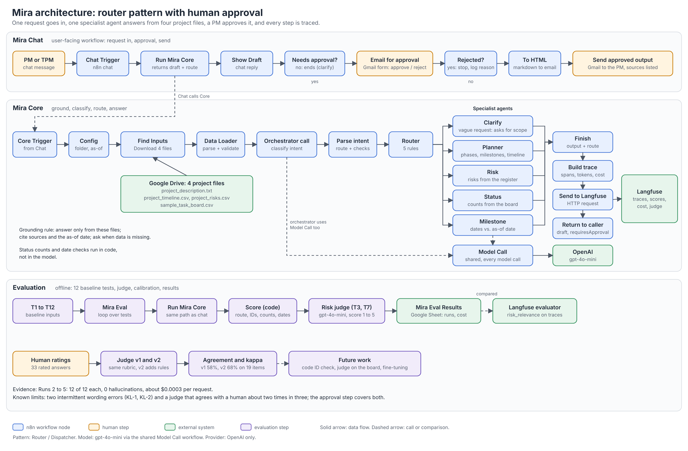

# Mira: AI-Powered Project Intelligence Assistant

Mira turns raw project files into a grounded project plan, risk assessment, weekly status report and milestone check. It was built on n8n Cloud for the Nexora Pvt. Ltd. capstone (Applied Agentic AI for PMs/TPMs, Interview Kickstart) and tested on the ABCDE Ltd. AI Adoption Project.

A router sends each request to one specialist agent. The agent answers only from four project files, and a PM approves the answer by email before it is sent. Every request is traced in Langfuse.



## What Mira does

| Request | Specialist | Output |
| --- | --- | --- |
| "Generate a project plan for the AI Adoption Project" | Planner | Phases, milestones and timeline from the project description and timeline |
| "Generate a risk assessment" / "Top 3 risks" | Risk assessor | Categorised risks with impact and mitigation from the risk register |
| "Weekly status report for Sprint 3" | Status reporter | Tasks by status (done, in progress, to do, blocked), counted in code from the task board |
| "Which tasks are blocked or at risk?" / "Milestones in the next 2 weeks?" | Milestone tracker (extended capability) | Blocked and at-risk tasks, and upcoming milestones against an as-of date |
| A vague request ("We want a chatbot") | Clarify | Asks for scope, goals, timeline and team size; invents nothing |

Plans, risk assessments and reports go through human approval. Clarify replies skip it by design, because they contain no generated claims.

A weekly status report can also run on a schedule: the Mira Weekly workflow (Schedule Trigger, Mira Core, approval email, send) is published with the timezone set to America/Los_Angeles. It was tested end to end with a manual run on 2026-10-26 (see `evidence/7_weekly-*`); the first unattended scheduled run has not yet been observed.

## Repository layout

```
README.md
workflows/    n8n workflow exports (JSON)
docs/         architecture diagram, BRD, PRD, ideation (Q1), build writeup (Q2), program charter (Q3), reflection (Q4), failure analysis, evaluation results
evidence/     screenshots: workflow canvases, Mira in action, Langfuse traces and cost
data/         the four project input files and the 12 baseline test inputs
```

## Workflows

| File | Purpose |
| --- | --- |
| `workflows/mira-chat.json` | Chat trigger, approval email (Gmail), approved send |
| `workflows/mira-core.json` | Loads the input files, classifies the request, routes it to a specialist, builds the trace and sends it to Langfuse |
| `workflows/model-call.json` | Shared sub-workflow that calls the model (gpt-4o-mini) and returns text, token counts and latency |
| `workflows/mira-eval.json` | Runs the 12 baseline tests through Mira Core, scores them, and writes results to a Google Sheet |
| `workflows/mira-judge-calibration.json` | Compares the risk-relevance judge with human ratings |

## Setup

1. **n8n.** Import the five workflows (Workflows, then Import from file). Mira Core calls Model Call, and Mira Chat calls Mira Core, so import all of them and relink the Execute Workflow nodes to your copies.
2. **Credentials.** The exports contain no keys. Create these in n8n and attach them to the nodes that need them:
   - OpenAI API key (Model Call)
   - Google Drive and Google Sheets (reading the inputs, writing evaluation results)
   - Gmail (approval email and approved send)
   - Langfuse public and secret keys (Send to Langfuse)
3. **Input files.** Put the four files from `data/` in one Drive folder and set the folder in the `Config` node of Mira Core, together with the as-of date used for date checks (2026-04-20 in the tests).
4. **Langfuse.** Create a project and add the keys to the credential above. Optionally add an LLM-as-judge evaluator named `risk_relevance` (score 1 to 5 plus a list of unsupported items) to score risk answers.
5. **Publish** Mira Core, Model Call and Mira Chat, then open the chat from Mira Chat.

## Running it

- **Chat:** send a request such as "Generate a risk assessment for the AI Adoption Project at ABCDE Ltd." If approval is needed, an email arrives with a form; approve or reject with a reason, and the approved output is emailed.
- **Baseline tests:** execute Mira Eval. It runs T1 to T12 and writes one row per test to the results sheet (route, pass, hallucination flag, latency, tokens, cost, judge score where it applies).

## Evaluation results

| Run | Change | Tests passed | Hallucinations | Avg latency | Cost per request |
| --- | --- | --- | --- | --- | --- |
| Run 2 | After orchestrator fix | 12 of 12 | 0 | 3,124 ms | $0.000319 |
| Run 3 | T11 prompt fix and stricter check | 12 of 12 | 0 | 2,888 ms | $0.000318 |
| Run 4 | Risk-relevance judge added (T3, T7) | 12 of 12 | 0 | 2,814 ms | $0.000315 |
| Run 5 | Judge rule 8 (risks must be in the register) | 12 of 12 | 0 | 3,472 ms | $0.00032 |

Average latency covers the 8 tests that make a model call; the 4 clarify tests (T2, T4, T6, T9) do not. Costs for Runs 2 to 4 are calculated from tokens, and Run 5 is measured in Langfuse. A project plan costs about $0.0006.

**Judge calibration.** The risk judge was compared with human ratings on 33 answers (a 14-item baseline and a 19-item test set). Agreement with a human on pass/fail: 64% on the baseline (kappa 0.26); on the test set 58% for v1 (kappa 0.23) and 68% for v2 (kappa 0.27). The judge is a screen, not a replacement for a reviewer. Judge v2 is evaluated offline and not deployed.

## Known limitations

Ten limitations (KL-1 to KL-10) are logged with their cause and mitigation in the failure analysis in `docs/` and in the results sheet. The main ones:
- Two intermittent wording errors passed the code checks: a wrong project start date in the plan (KL-1) and "no blocked items" in a Sprint 2 update (KL-2). The approval step covers both.
- Scoring is by code heuristics, so it cannot judge the accuracy of prose (KL-5).
- The judge agrees with a human about two times in three, and judge v2's task-ID rule wrongly rejects valid task IDs (KL-8, KL-9).
- A second-model comparison was not run, because gpt-4.1-mini is blocked on the project's OpenAI allow-list (KL-7).

## Security and privacy

- The exports contain no API keys, tokens or webhook secrets; credentials are created per user in n8n.
- OpenAI is the only approved model provider. Adding another needs a requirement change.
- Nothing is sent externally without human approval.
- The project files are sample data from the course.

## Future work

- Check task and risk IDs in code against the task board and risk register.
- Give the judge the full task board, then retest on fresh human-rated items.
- Add a second-model comparison once the allow-list permits it.
- Fine-tune the planner or risk assessor on corrected examples (not done: too costly for this project).
- Add human annotation in Langfuse with annotation queues.

## Links

- Evaluation results sheet (Google Sheet, view only): ADD-SHARE-LINK-HERE. A downloaded copy is in `docs/Mira_Eval_Results.xlsx`.
- Requirements: `docs/` holds the BRD and PRD (v1.0, as built), the build writeup, program charter, reflection and failure analysis.
- Screenshots: `evidence/` (workflow canvases, executed runs, approval emails, Langfuse traces and risk_relevance scores).
